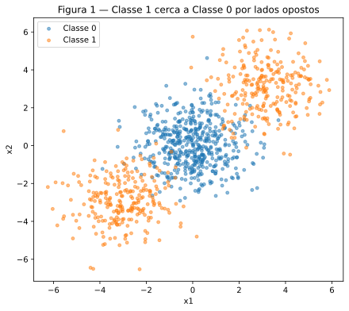
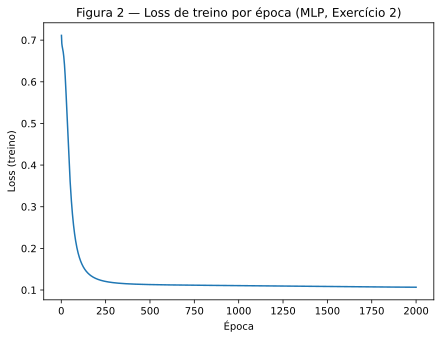
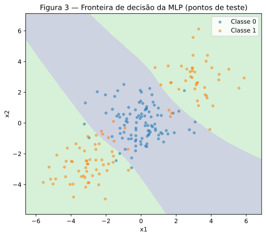
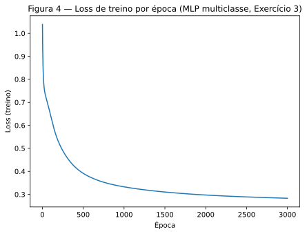
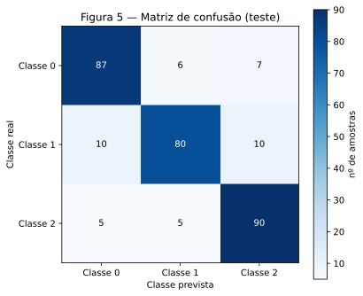
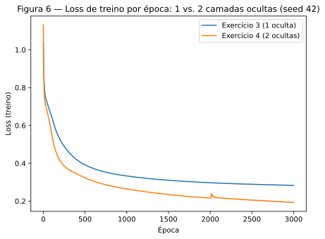

# 3. MLP

!!! abstract "Enunciado"

    [Exercises → MLP](https://insper.github.io/ann-dl/2026.2/exercises/mlp/){:target='_blank'}

!!! info "Sobre as seeds nos Exercícios 3 e 4"

    O enunciado fixa `rng = np.random.default_rng(42)` como regra global, mas também
    pede médias sobre "pelo menos 3 seeds" para a comparação de profundidade do
    Exercício 4 — as duas coisas não podem valer ao mesmo tempo (o próprio enunciado
    reconhece essa tensão). A resolução adotada aqui: os **dados** (geração e split)
    ficam fixos em `random_state=42`, idênticos nos Exercícios 3 e 4 — é o "mude uma
    coisa de cada vez" que o enunciado pede. O que varia entre as 3 seeds é só a
    **inicialização dos pesos** de cada rede, que é o jeito padrão de isolar o efeito da
    profundidade de uma inicialização sortuda ou azarada.

## Exercício 1 — Backpropagation à mão

### A — Forward pass

Rede 2-2-1, `tanh` nas duas camadas, com os valores do enunciado:

$$
\mathbf{x} = [0.5, -0.2], \quad y = 1.0
$$

$$
\mathbf{W}^{(1)} = \begin{bmatrix} 0.3 & -0.1 \\ 0.2 & 0.4 \end{bmatrix}, \quad
\mathbf{b}^{(1)} = [0.1, -0.2], \quad
\mathbf{W}^{(2)} = [0.5, -0.3], \quad
b^{(2)} = 0.2
$$

**Pré-ativação da camada oculta:** $\mathbf{z}^{(1)} = \mathbf{x}\mathbf{W}^{(1)} + \mathbf{b}^{(1)}$

$$
z^{(1)}_1 = (0.5)(0.3) + (-0.2)(0.2) + 0.1 = 0.21 \qquad
z^{(1)}_2 = (0.5)(-0.1) + (-0.2)(0.4) - 0.2 = -0.33
$$

$$
\mathbf{z}^{(1)} = [0.2100,\ -0.3300]
$$

**Ativação da camada oculta:** $\mathbf{h}^{(1)} = \tanh(\mathbf{z}^{(1)})$

$$
\mathbf{h}^{(1)} = [0.2070,\ -0.3185]
$$

**Pré-ativação de saída:** $u^{(2)} = \mathbf{h}^{(1)} \cdot \mathbf{W}^{(2)} + b^{(2)}$

$$
u^{(2)} = (0.2070)(0.5) + (-0.3185)(-0.3) + 0.2 = 0.3990
$$

**Saída:** $\hat{y} = \tanh(u^{(2)}) = 0.3791$

**Loss (MSE, N=1):** $L = (y - \hat{y})^2 = (1.0 - 0.3791)^2 = 0.3855$

### B — Backward pass

**Gradiente da saída.** Com $L = (y-\hat y)^2$:

$$
\frac{\partial L}{\partial \hat y} = -2(y - \hat y) = -2(1.0 - 0.3791) = -1.2417
$$

Como $\hat y = \tanh(u^{(2)})$, $\dfrac{\partial \hat y}{\partial u^{(2)}} = 1 - \hat y^2 = 1 - 0.3791^2 = 0.8563$. Pela regra da cadeia:

$$
\frac{\partial L}{\partial u^{(2)}} = \frac{\partial L}{\partial \hat y} \cdot \frac{\partial \hat y}{\partial u^{(2)}} = (-1.2417)(0.8563) = -1.0633
$$

**Gradientes de $\mathbf{W}^{(2)}$ e $b^{(2)}$.** Como $u^{(2)} = \mathbf{h}^{(1)}\cdot\mathbf{W}^{(2)} + b^{(2)}$:

$$
\frac{\partial L}{\partial \mathbf{W}^{(2)}} = \frac{\partial L}{\partial u^{(2)}} \cdot \mathbf{h}^{(1)} = (-1.0633)[0.2070, -0.3185] = [-0.2201,\ 0.3387]
$$

$$
\frac{\partial L}{\partial b^{(2)}} = \frac{\partial L}{\partial u^{(2)}} = -1.0633
$$

**Propagando para a camada oculta.** $\dfrac{\partial L}{\partial \mathbf{h}^{(1)}} = \dfrac{\partial L}{\partial u^{(2)}} \cdot \mathbf{W}^{(2)}$:

$$
\frac{\partial L}{\partial \mathbf{h}^{(1)}} = (-1.0633)[0.5, -0.3] = [-0.5316,\ 0.3190]
$$

Como $\mathbf{h}^{(1)} = \tanh(\mathbf{z}^{(1)})$, $\dfrac{\partial \mathbf{h}^{(1)}}{\partial \mathbf{z}^{(1)}} = 1 - (\mathbf{h}^{(1)})^2 = [0.9572,\ 0.8985]$, elemento a elemento:

$$
\frac{\partial L}{\partial \mathbf{z}^{(1)}} = \frac{\partial L}{\partial \mathbf{h}^{(1)}} \odot \left(1 - (\mathbf{h}^{(1)})^2\right) = [-0.5089,\ 0.2866]
$$

**Gradientes de $\mathbf{W}^{(1)}$ e $\mathbf{b}^{(1)}$.** Como $\mathbf{z}^{(1)} = \mathbf{x}\mathbf{W}^{(1)} + \mathbf{b}^{(1)}$, $\dfrac{\partial L}{\partial \mathbf{W}^{(1)}} = \mathbf{x}^T \otimes \dfrac{\partial L}{\partial \mathbf{z}^{(1)}}$ (produto externo):

$$
\frac{\partial L}{\partial \mathbf{W}^{(1)}} =
\begin{bmatrix} (0.5)(-0.5089) & (0.5)(0.2866) \\ (-0.2)(-0.5089) & (-0.2)(0.2866) \end{bmatrix}
=
\begin{bmatrix} -0.2544 & 0.1433 \\ 0.1018 & -0.0573 \end{bmatrix}
$$

$$
\frac{\partial L}{\partial \mathbf{b}^{(1)}} = \frac{\partial L}{\partial \mathbf{z}^{(1)}} = [-0.5089,\ 0.2866]
$$

### C — Atualização dos parâmetros

Com $\eta = 0.3$, $\theta_{\text{novo}} = \theta - \eta \cdot \partial L/\partial\theta$ para os 8 parâmetros:

$$
\mathbf{W}^{(1)}_{\text{novo}} = \begin{bmatrix} 0.3763 & -0.1430 \\ 0.1695 & 0.4172 \end{bmatrix}
\qquad
\mathbf{b}^{(1)}_{\text{novo}} = [0.2527,\ -0.2860]
$$

$$
\mathbf{W}^{(2)}_{\text{novo}} = [0.5660,\ -0.4016]
\qquad
b^{(2)}_{\text{novo}} = 0.5190
$$

Refazendo o forward pass com os parâmetros novos: $\hat y = 0.7181$, $L = 0.0794$ — **a loss cai** de 0.3855 para 0.0794, como esperado após um passo de gradiente descendente.

```python title="exercise1_check.py (verificação numérica, não substitui a derivação acima)"
--8<-- "docs/exercises/mlp/code/exercise1_check.py"
```

## Exercício 2 — Classificação binária

### A — Geração dos dados

`make_blobs` com centros `[[0,0], [3,3], [-3,-3]]`, `cluster_std=1.2`, `n_samples=[500,250,250]` — a Classe 1 (os dois blobs das pontas) cerca a Classe 0 (o blob do meio) por lados opostos.


/// caption
**Figura 1** — 1000 pontos: Classe 0 no centro, Classe 1 dividida nos dois cantos.
///

### B — Baseline linear

Regressão logística (`sklearn.linear_model.LogisticRegression`), treinada nos dados padronizados: **acurácia de teste = 47.50%** — pior que simplesmente chutar a classe majoritária (50%), porque não existe reta nenhuma que separe "o centro" dos "dois cantos opostos".

### C — MLP do zero

Implementada em `mlp.py`, reaproveitada nos Exercícios 3 e 4: forward, loss (entropia cruzada binária), backward com todo gradiente derivado à mão, e atualização por gradiente descendente em lote completo.

```python title="mlp.py"
--8<-- "docs/exercises/mlp/code/mlp.py"
```

```python title="exercise2.py"
--8<-- "docs/exercises/mlp/code/exercise2.py"
```

- **Arquitetura:** `[2, 8, 1]`, `tanh` na oculta, `sigmoid` na saída.
- **η = 0.5, 2000 épocas** (gradiente descendente em lote completo).
- **Loss final (treino):** 0.1067
- **Acurácia de teste:** **92.00%**


/// caption
**Figura 2** — Loss de treino por época.
///


/// caption
**Figura 3** — Fronteira de decisão sobre os pontos de teste — a MLP aprendeu uma
região curva ("faixa") em vez de uma reta.
///

### D — Análise

**Por que a baseline fica abaixo de 50% e a MLP passa de 90%?** Um classificador linear
só consegue desenhar **uma** reta, que divide o plano em dois semiplanos. Como a Classe 1
ocupa os dois cantos opostos e a Classe 0 fica entre eles, qualquer reta que tente
separar bem um dos cantos da Classe 0 automaticamente joga o canto oposto (também Classe
1) para o lado "errado" — não existe posição de reta que acerte os dois cantos ao mesmo
tempo. O resultado (47.50%) fica **abaixo** do chute da classe majoritária porque a
melhor reta possível, tentando equilibrar o erro nos dois lados, erra sistematicamente
mais do que acerta. A MLP, por ter uma camada oculta com `tanh`, consegue combinar várias
retas (uma por neurônio oculto) para desenhar uma fronteira **curva** — e é justamente
essa curva que a Figura 3 mostra.

**A forma da região (Figura 3).** A rede aprendeu uma região central, alongada na
diagonal, que envolve só a nuvem da Classe 0 — e deixa os dois cantos (Classe 1) de fora,
em uma única região conectada ao redor dela.

**Por que nenhuma reta produz essa região?** Uma reta só tem dois lados. A região
aprendida pela MLP tem a Classe 0 cercada **nos dois lados** pela Classe 1 (acima-direita
e abaixo-esquerda) — para separar isso com retas, seria preciso **pelo menos duas**
(uma de cada lado), e a interseção dos dois semiplanos "corretos" é exatamente esse tipo
de faixa. Uma única reta, por construção, não tem como representar uma região com a
Classe 0 "no meio" de dois grupos opostos da Classe 1.

## Exercício 3 — Multiclasse

### A — Geração dos dados

`make_classification` com `n_samples=1500`, `n_features=4`, `n_informative=4`,
`n_classes=3`, `n_clusters_per_class=2`, `class_sep=1.0`, `random_state=42` — 3 classes,
cada uma formada por **2 clusters** em 4 dimensões (6 clusters ao todo). Split 80/20
estratificado.

### B — Adaptação para 3 classes

Mesma `mlp.py` do Exercício 2, só trocando a camada de saída: 3 unidades, `softmax`, e
entropia cruzada categórica.

**Derivação de $\partial L / \partial \mathbf{u}$ (softmax + entropia cruzada categórica).**
Para uma amostra com classe verdadeira $c$ (rótulo one-hot $\mathbf y$), $p_k = \text{softmax}(\mathbf u)_k = e^{u_k} / \sum_j e^{u_j}$, e $L = -\log p_c$.

Pela regra da cadeia, $\partial L/\partial u_i = (\partial L/\partial p_c)(\partial p_c/\partial u_i)$, com $\partial L/\partial p_c = -1/p_c$. A derivada do softmax é:

$$
\frac{\partial p_c}{\partial u_i} =
\begin{cases}
p_c(1-p_c), & i = c \\
-p_c\, p_i, & i \neq c
\end{cases}
$$

Substituindo:

$$
\frac{\partial L}{\partial u_i} =
\begin{cases}
-\dfrac{1}{p_c}\, p_c(1-p_c) = p_c - 1, & i = c \\[4pt]
-\dfrac{1}{p_c}\, (-p_c\, p_i) = p_i, & i \neq c
\end{cases}
\quad\Longrightarrow\quad
\boxed{\dfrac{\partial L}{\partial \mathbf{u}} = \mathbf{p} - \mathbf{y}}
$$

A mesma forma simples `p - y` do caso binário (sigmoid + entropia cruzada binária) — é
exatamente o que `mlp.py` implementa em `backward` (`delta = (a_out - y_onehot) / n`).

```python title="exercise3.py"
--8<-- "docs/exercises/mlp/code/exercise3.py"
```

- **Baseline linear (regressão logística):** 66.33%
- **Arquitetura:** `[4, 16, 3]`, `tanh` na oculta, `softmax` na saída — 131 parâmetros.
- **η = 0.3, 3000 épocas.**
- **Loss final (treino):** 0.2831
- **Acurácia de teste:** **85.67%**


/// caption
**Figura 4** — Loss de treino por época (MLP multiclasse).
///


/// caption
**Figura 5** — Matriz de confusão no teste.
///

### C — Resultado

A matriz de confusão foi:

| real \ previsto | Classe 0 | Classe 1 | Classe 2 |
|---|---|---|---|
| **Classe 0** | 87 | 6 | 7 |
| **Classe 1** | 10 | 80 | 10 |
| **Classe 2** | 5 | 5 | 90 |

### D — Análise

**Par mais confundido.** Somando as duas direções de cada par (ex.: real-0-previsto-1 +
real-1-previsto-0), o par **Classe 0 / Classe 1** tem o maior total: `6 + 10 = 16` casos —
ligeiramente à frente do par Classe 1 / Classe 2 (`10 + 5 = 15`, um empate técnico) e bem
à frente de Classe 0 / Classe 2 (`7 + 5 = 12`).

**Por que esse par confunde mais.** Os dados têm só 4 dimensões informativas e 6 clusters
no total (2 por classe) — em um espaço de dimensão tão baixa para 6 clusters, é esperado
que alguns clusters de classes diferentes acabem posicionados perto uns dos outros por
acaso. A Classe 1, com clusters relativamente próximos dos de **ambas** as outras duas
classes (16 casos com a Classe 0, 15 com a Classe 2 — praticamente empatados), parece ser
a "classe do meio" geometricamente, sofrendo confusão dos dois lados quase igualmente,
enquanto Classe 0 e Classe 2 se confundem pouco diretamente entre si (12 casos).

**O que a camada oculta agregou.** A baseline linear (regressão logística) chega a
66.33%; a MLP chega a 85.67% — quase 20 pontos percentuais a mais. Como os clusters de
cada classe ficam espalhados em posições diferentes do espaço de 4 dimensões (2 por
classe), nenhuma fronteira linear única consegue capturar bem uma classe cujos pontos
estão divididos em duas regiões distintas; a camada oculta com `tanh` permite combinar
fronteiras para que cada um dos 6 clusters seja atribuído corretamente à sua classe,
mesmo quando os dois clusters da mesma classe não são vizinhos no espaço de entrada.

## Exercício 4 — Comparação de profundidade

### A — Rede mais profunda

Mesmos dados e hiperparâmetros do Exercício 3 (η = 0.3, 3000 épocas), mudando só a
profundidade: `[4, 16, 16, 3]` — 2 camadas ocultas de 16 unidades (contra 1 camada de 16
unidades no Exercício 3), para isolar o efeito da profundidade do efeito da largura.

```python title="exercise4.py"
--8<-- "docs/exercises/mlp/code/exercise4.py"
```

### B — Comparação controlada (média de 3 seeds: 42, 43, 44)


/// caption
**Figura 6** — Loss de treino por época: 1 camada oculta (Exercício 3) vs. 2 camadas
ocultas (Exercício 4), seed 42.
///

| Rede | Camadas ocultas | Parâmetros | Loss final (treino), média | Acurácia de teste, média |
|---|---|---|---|---|
| Exercício 3 | 1 | 131 | 0.2778 | 85.00% |
| Exercício 4 | 2 | 403 | 0.1805 | 84.11% |

**Diferença de acurácia (Ex. 4 − Ex. 3), média sobre 3 seeds: −0.89 p.p.** A rede mais
profunda **não** supera a mais rasa — pelo contrário, fica um pouco pior, apesar de ter
3× mais parâmetros e uma loss de treino bem mais baixa em todas as 3 seeds testadas.

### C — Análise

Os dados têm só 6 clusters em 4 dimensões, com `class_sep=1.0` (separação moderada) — uma
fronteira relativamente simples já dá conta de separar a maior parte dos pontos, como a
rede de 1 camada oculta do Exercício 3 mostra (85.67% num único run, 85.00% de média). Uma
segunda camada oculta adiciona **capacidade representacional** (403 parâmetros contra
131, suficiente para aproximar fronteiras bem mais complexas que o problema não precisa),
mas isso tem um **custo de otimização**: mais parâmetros significa uma superfície de loss
maior e mais difícil de navegar com o mesmo número de épocas e a mesma taxa de
aprendizado — e é exatamente isso que a Figura 6 e a tabela mostram.

**Loss de treino e acurácia de teste não contam a mesma história aqui.** A rede de 2
camadas chega a uma loss de treino **bem mais baixa** (0.18 vs. 0.28) em todas as 3 seeds
— ela se ajusta melhor aos dados de treino — mas isso não se traduz em acurácia de teste
melhor (84.11% vs. 85.00%). Isso é a assinatura de **sobreajuste leve**: a capacidade
extra está sendo usada para memorizar particularidades do conjunto de treino que não
generalizam, em vez de capturar uma estrutura que ajudaria no teste.

**Quando a profundidade extra compensaria?** Em um problema com fronteira de decisão
genuinamente mais complexa — mais clusters por classe, menor `class_sep` (mais
sobreposição exigindo combinações mais sutis de fronteiras), ou uma relação entre
entrada e classe que não seja bem aproximada por poucas dobras lineares combinadas. Neste
dataset específico, a profundidade extra simplesmente não tem "trabalho" que justifique
o custo de otimização adicional.

## Results summary

| # | Item | Valor |
|---|------|-------|
| 1 | Ex. 1 — pré-ativações e ativações ocultas | `z¹ = [0.2100, -0.3300]`, `h¹ = [0.2070, -0.3185]` |
| 2 | Ex. 1 — pré-ativação, previsão e loss de saída | `u² = 0.3990`, `ŷ = 0.3791`, `L = 0.3855` |
| 3 | Ex. 1 — 8 parâmetros atualizados | `W¹=[[0.3763,-0.1430],[0.1695,0.4172]]`, `b¹=[0.2527,-0.2860]`, `W²=[0.5660,-0.4016]`, `b²=0.5190` |
| 4 | Ex. 2 — acurácia de teste da baseline linear | 47.50% |
| 5 | Ex. 2 — arquitetura e acurácia de teste da MLP | `[2, 8, 1]`, 92.00% |
| 6 | Ex. 3 — arquitetura e acurácia de teste da MLP | `[4, 16, 3]`, 85.67% |
| 7 | Ex. 3 — par de classes mais confundido | Classe 0 / Classe 1 (16 casos) |
| 8 | Ex. 4 — arquitetura e acurácia de teste da MLP | `[4, 16, 16, 3]`, 84.11% (média de 3 seeds) |
| 9 | Ex. 4 — diferença de acurácia em relação ao Ex. 3 | −0.89 p.p. (média de 3 seeds) |
