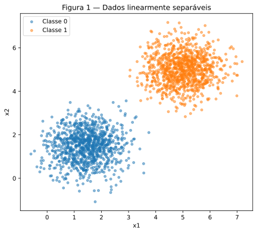
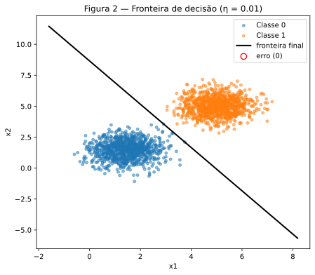
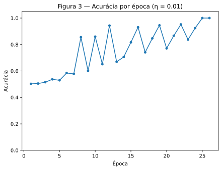
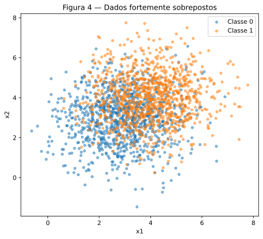
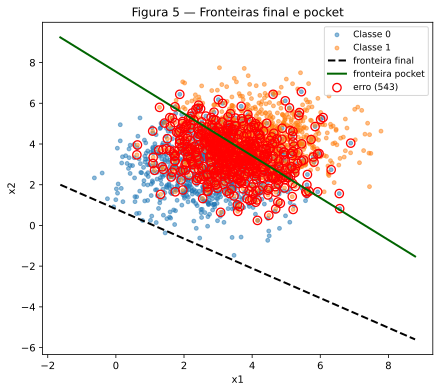
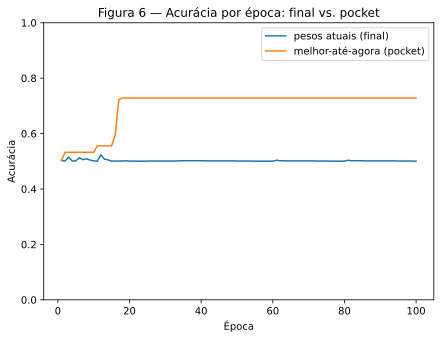

# 2. Perceptron

!!! abstract "Enunciado"

    [Exercises → Perceptron](https://insper.github.io/ann-dl/2026.2/exercises/perceptron/){:target='_blank'}

## Exercício 1 — Dados separáveis

### A — Geração dos dados

Duas classes 2D geradas por distribuições normais multivariadas bem separadas (médias
`[1.5, 1.5]` e `[5, 5]`, mesma covariância `[[0.5, 0], [0, 0.5]]` para as duas), 1000
amostras cada, com `rng = np.random.default_rng(42)`.

```python title="data.py"
--8<-- "docs/exercises/perceptron/code/data.py"
```


/// caption
**Figura 1** — As 2000 amostras (1000 por classe). As nuvens não se tocam.
///

### B — Implementação do perceptron

Perceptron implementado do zero (sem `sklearn`), com a regra de atualização para
rótulos `{0, 1}`: `w ← w + η(y − ŷ)x` e `b ← b + η(y − ŷ)`, parando quando uma passada
completa pelos dados não gera nenhuma atualização, ou ao atingir 100 épocas. Os pesos
iniciais vêm de `rng.normal(0, 0.01, size=2)` e `b = 0` — nunca pesos exatamente
zero, pelo que a Parte D explica.

```python title="perceptron.py"
--8<-- "docs/exercises/perceptron/code/perceptron.py"
```

### C — Treino e figuras

Treinado com `η = 0.01`:

- **w final:** `[0.0505, 0.0289]`
- **b final:** `-0.2500`
- **Épocas até convergência:** 26
- **Acurácia final:** 100%

```python title="exercise1.py"
--8<-- "docs/exercises/perceptron/code/exercise1.py"
```


/// caption
**Figura 2** — Fronteira final (η = 0.01). Zero pontos mal classificados.
///


/// caption
**Figura 3** — Acurácia por época (η = 0.01). Chega a 100% na época 26.
///

### D — Análise

**1. Por que dados separáveis convergem rápido?**
A contagem de atualizações por época foi
`[3, 3, 4, 4, 3, 4, 3, 4, 2, 4, 2, 4, 2, 3, 3, 3, 2, 3, 3, 2, 3, 3, 2, 3, 1, 0]` — uma
tendência de queda até chegar a 0 na época 26, que é o critério de parada. Isso é
exatamente o que o teorema de convergência do perceptron prevê: como as classes têm
margem positiva (a distância entre os centros, ≈ 4.95, é bem maior que o desvio padrão
de cada nuvem, ≈ 0.71), o número total de atualizações até encontrar uma fronteira
separadora é limitado por `(R/γ)²` (R = raio dos dados, γ = margem) — um número finito e
pequeno quando a margem é generosa. A cada atualização, a regra `w ← w + η(y − ŷ)x`
empurra a fronteira na direção que corrige aquele ponto, e como as classes mal se
encostam, poucos pontos (só os mais próximos da fronteira) continuam sendo
reclassificados a cada passada — por isso a contagem cai e logo chega a zero.

**2. Reexecução com η = 1.0.**

- **w final:** `[5.8706, 3.3592]`
- **b final:** `-31.0000`
- **Épocas até convergência:** 37
- **Acurácia final:** 100%
- **Similaridade de cosseno entre `w/‖w‖` dos dois runs:** `1.000000`

As direções finais são praticamente idênticas (cosseno ≈ 1) — ou seja, η = 0.01 e
η = 1.0 convergem para **a mesma fronteira**, só que em números de épocas diferentes (26
vs. 37). Isso mostra o que η realmente controla aqui: o **tamanho do passo** de cada
correção, não **se** uma correção acontece (isso depende só do sinal de `w·x + b`, que
não muda com o tamanho de η). Com pesos iniciais de magnitude ≈ 0.01, bem menores que a
separação entre as classes (≈ 5), o ponto de partida é "esquecido" rapidamente pelas
primeiras atualizações em ambos os casos — por isso as duas direções finais quase
coincidem, mesmo com passos de tamanhos tão diferentes.

**3. Prova algébrica — por que, partindo de `w = 0, b = 0`, η não teria efeito nenhum.**

Sejam dois treinos com taxas `η₁` e `η₂`, ambos partindo de `w⁽⁰⁾ = 0`, `b⁽⁰⁾ = 0`, e
vendo os mesmos pontos na mesma ordem. Afirmação: em todo passo `t`,
`w₂⁽ᵗ⁾ = (η₂/η₁) w₁⁽ᵗ⁾` e `b₂⁽ᵗ⁾ = (η₂/η₁) b₁⁽ᵗ⁾`.

*Prova por indução.* Base (`t = 0`): `0 = (η₂/η₁)·0`, vale trivialmente. Passo indutivo:
suponha que vale em `t`. Para o próximo ponto `x`, a previsão de cada run é
`ŷᵢ = step(wᵢ⁽ᵗ⁾·x + bᵢ⁽ᵗ⁾)`. Como `w₂⁽ᵗ⁾·x + b₂⁽ᵗ⁾ = (η₂/η₁)(w₁⁽ᵗ⁾·x + b₁⁽ᵗ⁾)` e
`η₂/η₁ > 0`, multiplicar por essa constante positiva não muda o sinal — logo
`ŷ₂ = ŷ₁`. As duas redes tomam **a mesma decisão** nesse ponto: ou as duas atualizam
(com o mesmo `y − ŷ`), ou nenhuma atualiza. Se atualizam:
`w₂⁽ᵗ⁺¹⁾ = w₂⁽ᵗ⁾ + η₂(y−ŷ)x = (η₂/η₁)w₁⁽ᵗ⁾ + η₂(y−ŷ)x = (η₂/η₁)[w₁⁽ᵗ⁾ + η₁(y−ŷ)x] = (η₂/η₁)w₁⁽ᵗ⁺¹⁾`
(e análogo para `b`). Se nenhuma atualiza, a igualdade se mantém trivialmente. Por
indução, vale em todo passo — os dois runs cometem exatamente os mesmos erros, na mesma
ordem, param na mesma época, e terminam com `w(η₂) = (η₂/η₁) w(η₁)`. Como a fronteira é
`{x : w·x + b = 0}` e escalar por uma constante positiva não muda esse conjunto, **a
fronteira final e o número de épocas são idênticos para qualquer η** — a única coisa que
muda é a magnitude (irrelevante) do vetor de pesos.

Conferindo isso no código (treino partindo de `w = [0, 0]`, `b = 0`):

- **Épocas:** 37 para η = 0.01, 37 para η = 1.0 — idênticas.
- **`w(η=1.0) / w(η=0.01)`:** `[100.0, 100.0]` — exatamente `η₂/η₁ = 1.0/0.01 = 100`.
- **`b(η=1.0) / b(η=0.01)`:** `100.0000` — idem.

Isso confirma a prova à risca. A pequena diferença que vimos no item 2 (26 vs. 37
épocas, com os pesos iniciais de verdade) não contradiz a prova — ela só não se aplica,
porque a prova depende de `w⁽⁰⁾ = b⁽⁰⁾ = 0` exatamente, e o enunciado pede pesos
iniciais **não nulos** (`rng.normal(0, 0.01, ...)`). Com um ponto de partida não-nulo, a
base da indução já falha, e os dois runs podem divergir em quais pontos erram em cada
passo — daí a diferença (pequena, porque a margem é grande) no número de épocas.

## Exercício 2 — Dados sobrepostos

### A — Geração dos dados

Duas classes 2D com médias próximas e covariância bem maior que no Exercício 1 (médias
`[3, 3]` e `[4, 4]`, covariância `[[1.5, 0], [0, 1.5]]` para as duas), 1000 amostras
cada — a sobreposição é proposital.


/// caption
**Figura 4** — As 2000 amostras (1000 por classe). As nuvens se misturam bastante.
///

### B — Treino com pocket

Reaproveita o **mesmo** `perceptron.py` do Exercício 1, sem nenhuma mudança na regra de
atualização — a única adição é o rastreamento do *pocket*: a cada atualização, se a
acurácia no dataset inteiro com os pesos novos for a melhor já vista, ela é copiada para
`pocket_w`/`pocket_b` (já implementado em `train_perceptron` via `track_pocket=True`,
mostrado na Parte B do Exercício 1). Como os dados não são separáveis, o treino nunca
para sozinho — as 100 épocas sempre são executadas por completo.

```python title="exercise2.py"
--8<-- "docs/exercises/perceptron/code/exercise2.py"
```

**Pesos finais (última época):**

- **w:** `[0.0361, 0.0494]`
- **b:** `-0.0400`
- **Acurácia:** 50.05%

**Pesos do pocket (melhores já vistos, encontrados na época 18):**

- **w:** `[0.0068, 0.0066]`
- **b:** `-0.0500`
- **Acurácia:** 72.85%

### C — Figuras


/// caption
**Figura 5** — Fronteira final (tracejada, bem afastada dos dados) vs. pocket (sólida,
cruzando a região de sobreposição). Erros do pocket em vermelho.
///


/// caption
**Figura 6** — Acurácia por época: pesos atuais (nunca se estabiliza) vs. pocket
(sobe e se estabiliza perto de 73%).
///

### D — Análise

**1. Por que o final e o pocket ficam tão diferentes?**
A cada erro, `b` se move exatamente `η(y − ŷ) = ±0.01` — um passo fixo e pequeno.
`w`, por sua vez, se move `η(y − ŷ)x`, cuja norma é `η‖x‖ ≈ 0.01 × 5 = 0.05` — **5 vezes
maior** que o passo de `b` (a dica do enunciado). Como os dados não são separáveis, erros
acontecem dos dois lados o tempo todo, nas 100 épocas inteiras — `w` e `b` fazem uma
espécie de passeio aleatório guiado por quais pontos estão errados no momento, e como o
passo de `w` é 5× maior, ele "anda" muito mais rápido do que `b` consegue acompanhar para
recentralizar a reta. No fim, `w = [0.036, 0.049]` e `b = -0.04` têm magnitudes
parecidas — mas uma fronteira bem centralizada nessa nuvem (centrada perto de
`(3.5, 3.5)`) precisaria de algo como `b ≈ -w·(3.5, 3.5) ≈ -0.30`, quase **8× maior em
módulo** do que o `b` que o treino final produziu. Na prática (Figura 5), a reta final
fica deslocada para fora de quase toda a nuvem de pontos — ela classifica quase tudo como
uma única classe, daí a acurácia de 50.05%, só um pouco acima de jogar uma moeda.

**2. Por que a curva do Exercício 2 nunca se estabiliza, ao contrário da do Exercício 1?**
O teorema de convergência do perceptron garante um número *finito* de atualizações — e
uma fronteira perfeitamente separadora ao final — **somente se existir margem positiva**
entre as classes (dados linearmente separáveis). Aqui as médias ficam a uma distância de
apenas `√2 ≈ 1.41`, enquanto cada nuvem tem desvio padrão `√1.5 ≈ 1.22` em cada eixo: não
existe reta nenhuma com erro zero, logo não existe margem `γ > 0`, e a hipótese do
teorema simplesmente não vale para este dataset. Sem essa garantia, toda época ainda
encontra pontos do lado "errado" de qualquer `(w, b)` atual, gerando atualizações sem
fim — os pesos nunca param de se mover, e por isso a curva "pesos atuais" da Figura 6
oscila ao redor de 50% em vez de subir e estabilizar como a Figura 3.

**3. Mais épocas ou um η menor resolveriam?** Nenhum dos dois — e dá para justificar
direto pela regra de atualização, sem precisar rodar nada de novo:

- **Mais épocas não ajudam.** O critério de parada é "uma passada inteira sem nenhuma
  atualização". Como não existe fronteira com erro zero para estes dados, **sempre**
  existe pelo menos um ponto do lado errado de qualquer `(w, b)`, então uma época com
  zero atualizações é, por construção, impossível de acontecer — não importa se o limite
  for 100, 10&nbsp;000 ou 1 milhão de épocas, o comportamento de "passeio aleatório" dos
  pesos continua do mesmo jeito.
- **Um η menor também não ajuda.** Pela prova do Exercício 1 (item D.3): partindo de
  pesos iniciais nulos, mudar η só reescala a magnitude de `(w, b)` — quem erra em cada
  passo depende exclusivamente do **sinal** de `w·x + b`, que não muda com o tamanho de
  η. Diminuir η encolhe o tamanho de cada passo do passeio aleatório, mas não dá a ele
  nenhuma propriedade de convergência que não existia antes — é o mesmo passeio sem
  destino, só que em passos menores. A solução de verdade não está em ajustar
  hiperparâmetros do perceptron puro: é guardar o melhor resultado já visto durante o
  treino, que é exatamente o que o pocket, já implementado, faz.

## Results summary

| # | Item | Valor |
|---|------|-------|
| 1 | Exercício 1 — `w` e `b` finais | `w = [0.0505, 0.0289]`, `b = -0.2500` |
| 2 | Exercício 1 — épocas até convergência | 26 |
| 3 | Exercício 1 — acurácia final | 100% |
| 4 | Exercício 1 — épocas e acurácia final com η = 1.0 | 37 épocas, 100% |
| 5 | Exercício 2 — `w` e `b` finais | `w = [0.0361, 0.0494]`, `b = -0.0400` |
| 6 | Exercício 2 — acurácia dos pesos finais | 50.05% |
| 7 | Exercício 2 — acurácia dos pesos do pocket | 72.85% |
| 8 | Exercício 2 — época em que o pocket atingiu o melhor valor | 18 |
